# MIT Diffusion：三份作业的公式、架构与实现

本文按本地作业的 Part 和题号展开：[Lab One](lab_one.ipynb) → [Lab Two](lab_two.ipynb) → [Lab Three](lab_three.ipynb)。结果图来自 Notebook 的已保存输出或已有 checkpoint，不是为本文重新训练的结果。文末的单元格编号从 1 开始，**包括 Markdown 单元格**，不是 Jupyter 的 `In [n]`。

- [Lab 1：从 ODE／SDE 到 Langevin 采样](#lab-1)
- [Lab 2：从条件概率路径到 Flow／Score Matching](#lab-2)
- [Lab 3：从类别引导到像素与潜空间生成](#lab-3)
  - [VAE 推导：边缘似然、ELBO 与代码损失](#vae-elbo)
- [组件、公式与函数对照](#code-map)

## 阅读约定

| 符号 | 含义 |
|---|---|
| $X_t$ / $x$ | 时间 $t$ 的随机状态 / 用于计算的一个取值。Lab 1 的仿真时间可超过 1；Lab 2–3 的生成方向是 $t=0$（源）到 $t=1$（数据）。 |
| $z$ | 条件路径的终点样本。Lab 2 是二维数据点，Lab 3 Part 1–3 是真实图像；Part 4–5 将 VAE 隐变量写作 $z_{\rm lat}$，潜空间路径终点写作 $z_\bullet$。 |
| $y$ / $\varnothing$ | 类别标签 / 人工添加的空标签。它不是终点 $z$。 |
| $u_t(x)$ / $s_t(x)$ | 速度或漂移 / score，即对**状态**求导的对数密度梯度。两者不是同一个预测量。 |
| $h$ / $\sigma$ / $\beta_t$ | 数值积分步长 / SDE 扩散系数 / 高斯路径的标准差。VAE 的 KL 权重另写作 $\beta_{\rm VAE}$。 |

整套作业有两条需要分开的流程：**训练时**，用真实终点和随机时间直接构造 $X_t$ 及监督目标，不在每个 batch 内解 ODE；**生成时**，没有真实终点，从简单分布采样，再由学到的场一步步推进。

<a id="lab-1"></a>

## Lab 1：Simulating ODEs and SDEs

### Part 0：定义动力系统

令 $u_t:\mathbb R^d\to\mathbb R^d$，$W_t$ 是 $d$ 维标准布朗运动。作业的各向同性情形为：

$$
\begin{aligned}
\text{ODE:}\quad & dX_t=u_t(X_t)\,dt, & X_0=x_0,\\
\text{SDE:}\quad & dX_t=u_t(X_t)\,dt+\sigma_t\,dW_t, & X_0=x_0.
\end{aligned}
$$

给定初值，ODE 由速度场决定轨迹；SDE 即使初值相同也能生成不同轨迹。`ODE` 只定义 `drift_coefficient`；`SDE` 再定义 `diffusion_coefficient`。动力学类只计算系数，不负责循环和采样噪声。

### Part 1 / Q1.1：Euler 与 Euler–Maruyama

在递增网格 $t_0<\cdots<t_N$ 上，记 $h_k=t_{k+1}-t_k$。布朗增量满足 $W_{t_{k+1}}-W_{t_k}\sim\mathcal N(0,h_k I_d)$，因此每步独立取 $\xi_k\sim\mathcal N(0,I_d)$：

$$
\begin{aligned}
x_{k+1}^{\mathrm{Euler}} &= x_k+h_k u_{t_k}(x_k),\\
x_{k+1}^{\mathrm{EM}} &= x_k+h_k u_{t_k}(x_k)+\sqrt{h_k}\,\sigma_{t_k}\xi_k.
\end{aligned}
$$

漂移乘 $h_k$，噪声乘 $\sqrt{h_k}$；把后者写成 $h_k$ 会得到错误的增量方差。令 $\sigma_t=0$，两种更新式一致。`Simulator.simulate` 在左端点调用 `step`，只返回 $x_N$；`simulate_with_trajectory` 连初值一起记录，形状为 `B × (N+1) × d`。

### Part 2 / Q2.1：缩放 Brownian Motion

$$
dX_t=\sigma\,dW_t,\qquad X_0=0
\quad\Longrightarrow\quad
X_t=\sigma W_t,\qquad X_t\sim\mathcal N(0,\sigma^2 t I_d).
$$

`BrownianMotion` 返回零漂移和常数扩散系数。终点分布的标准差是 $|\sigma|\sqrt t$：$\sigma$ 越大，轨迹和终点直方图越分散；$\sigma$ 接近零时，轨迹几乎停在起点。固定 $\sigma\ne0$ 时，方差随时间增长，没有 OU 那样的平稳高斯。

### Part 2 / Q2.2：Ornstein–Uhlenbeck（OU）过程

`OUProcess` 返回 $-\theta x$ 和 $\sigma$。对于固定初值 $x_0$、$\theta>0$，用积分因子 $e^{\theta t}$ 解得：

$$
\begin{aligned}
dX_t &= -\theta X_t\,dt+\sigma\,dW_t,\\
X_t &= e^{-\theta t}x_0+\sigma\int_0^t e^{-\theta(t-s)}\,dW_s,\\
X_t\mid X_0=x_0 &\sim \mathcal N\!\left(e^{-\theta t}x_0,\frac{\sigma^2}{2\theta}(1-e^{-2\theta t}) I_d\right),\\
X_t &\xrightarrow[t\to\infty]{\mathrm{law}} \mathcal N\!\left(0,\frac{\sigma^2}{2\theta}I_d\right).
\end{aligned}
$$

固定 $\sigma>0$，增大 $\theta$ 会让初值记忆更快消失，且平稳分布变窄；固定 $\theta>0$，增大 $\sigma$ 会加宽平稳分布。噪声不为零时，**收敛的是分布，不是每条轨迹停在 0**。若保持 $D=\sigma^2/(2\theta)$ 不变，则平稳分布相同；作业还将每组终止时间设为 $15/\sigma^2$：用 $\tau=\sigma^2 t$ 表示时间后，过程满足 $dX=-X\,d\tau/(2D)+d\widetilde W_\tau$，因而同一行在重标时间后具有相同的动力学。

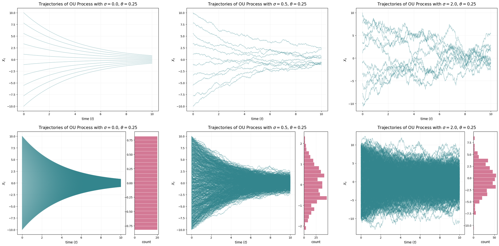

*图 1 · Lab 1，单元格 28。$\theta=0.25$ 固定，三列为 $\sigma=0,0.5,2$；上排看个体轨迹，下排看批量轨迹及有限时间的终点分布。*

### Part 3 / Q3.1：用目标分布的 score 构造 Langevin 动力学

`Sampleable` 只要求能抽样；`Density` 要求能算 `log_density(x)`，再用 `vmap(jacrev(...))` 求逐样本的 `score(x)`。对平滑正密度 $p$，有 $s_p(x)=\nabla_x\log p(x)=\nabla_xp(x)/p(x)$。若 $p(x)=\sum_j\pi_j\mathcal N(x;\mu_j,\Sigma_j)$ 是混合高斯，则 $s_p(x)$ 是各分量 score 的**后验责任度**加权，而非按先验权重直接平均：

$$
s_p(x)=-\sum_j r_j(x)\Sigma_j^{-1}(x-\mu_j),\qquad
r_j(x)=\frac{\pi_j\mathcal N(x;\mu_j,\Sigma_j)}{\sum_\ell\pi_\ell\mathcal N(x;\mu_\ell,\Sigma_\ell)}.
$$

`LangevinSDE` 把密度的 score 接进漂移，源分布只负责初值。若当前密度为 $\rho_t$，其 Fokker–Planck 方程为：

$$
\begin{aligned}
dX_t&=\tfrac12\sigma^2 s_p(X_t)\,dt+\sigma\,dW_t,\\
\partial_t\rho_t&=-\tfrac12\sigma^2\nabla\!\cdot(\rho_t s_p)+\tfrac12\sigma^2\Delta\rho_t,\\
\left.\partial_t\rho_t\right|_{\rho_t=p}&=-\tfrac12\sigma^2\nabla\!\cdot(\nabla p)+\tfrac12\sigma^2\Delta p=0.
\end{aligned}
$$

这说明 $p$ 是**连续时间**的平稳分布；从其他初值到 $p$ 的收敛还依赖遍历性、运行时间和模式间混合，有限步长也会引入偏差。较大的 $\sigma$ 同时增强漂移（平方）和随机扰动（一次），不能只调大 $\sigma$ 而保持粗步长：以 OU 为例，离散漂移的系数是 $1-h\theta$，稳定需 $|1-h\theta|<1$。

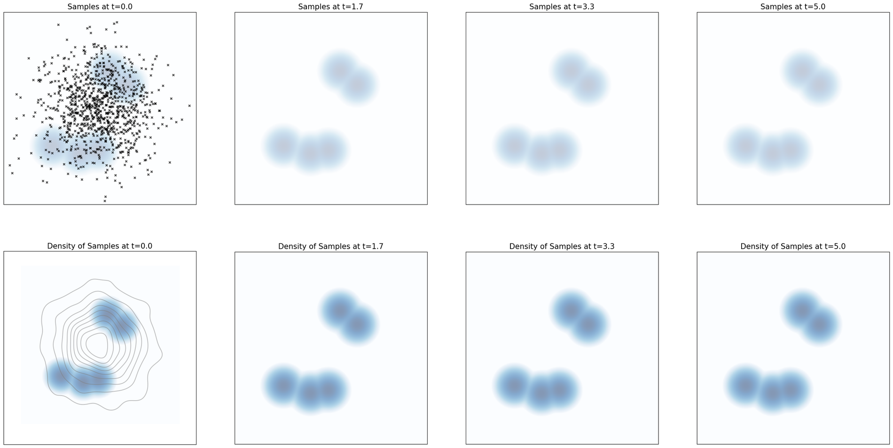

*图 2 · Lab 1，单元格 42 当前参数为 $\sigma=100$、1000 个网格点覆盖 $[0,5]$。有限窗口里后续几列主要剩目标密度底图，不是采样成功的证据；要区分蓝色目标背景、黑色样本和灰色 KDE。可选动画单元格 46 则使用 $\sigma=0.6$。*

### Part 3 / Q3.2：证明 OU 是高斯目标的 Langevin 特例

设 $\theta,\sigma>0$，$D=\sigma^2/(2\theta)$，$p=\mathcal N(0,DI_d)$。则 $\log p(x)=-\tfrac d2\log(2\pi D)-\lVert x\rVert^2/(2D)$，所以

$$
\nabla_x\log p(x)=-\frac{x}{D}=-\frac{2\theta}{\sigma^2}x,
\qquad \frac{\sigma^2}{2}\nabla_x\log p(x)=-\theta x.
$$

代回 Q3.1 的 Langevin SDE 就得到 Q2.2 的 OU；给定相同初值时两者是同一个过程。这也解释了为什么按 $D$ 分组能得到相同的平稳目标。

<a id="lab-2"></a>

## Lab 2：Flow Matching and Score Matching

### Part 0：复用 Lab 1 的基础组件

复用分布对象、绘图函数和 Euler／Euler–Maruyama。和 Lab 1 共用一条 `(T,)` 时间网格不同，Lab 2 将网格广播成 `(B,T,1)`，取 `ts[:, k]` 得到 `(B,1)` 的 $t$ 和 $h$，可直接与 `(B,d)` 状态运算。`record_every` 只负责选取要展示的帧，并保留最后一帧，不改变积分步长。

### Part 1：条件路径、边缘路径与生成目标

先抽取终点 $Z\sim p_{\mathrm{data}}$，再给定 $Z=z$ 定义 $p_t(x\mid z)$。本作业的条件路径共享同一起点分布：

$$
\begin{aligned}
p_0(x\mid z)&=p_{\mathrm{simple}}(x), & p_1(x\mid z)&=\delta_z(x),\\
p_t(x)&=\int p_t(x\mid z)\,p_{\mathrm{data}}(dz), &
p_0&=p_{\mathrm{simple}},\quad p_1=p_{\mathrm{data}}.
\end{aligned}
$$

`sample_marginal_path(t)` 就执行“抽 $z$ → 给定 $z,t$ 抽 $x$”，无需对密度做积分。**固定 $z$** 时，所有样本在终点汇到同一点；**每次重抽 $z$** 时，终点才覆盖整个数据分布。条件 ODE 的速度 $u_t^{\rm ref}(x\mid z)$ 通过连续性方程推广到边缘速度：

$$
\begin{aligned}
\partial_t p_t(x\mid z)&=-\nabla_x\!\cdot\left[p_t(x\mid z)u_t^{\rm ref}(x\mid z)\right],\\
\partial_t p_t(x)&=-\nabla_x\!\cdot\left[p_t(x)u_t^{\rm ref}(x)\right],\\
u_t^{\rm ref}(x)&=\frac{\int p_t(x\mid z)u_t^{\rm ref}(x\mid z)\,p_{\mathrm{data}}(dz)}{p_t(x)}
=\mathbb E[u_t^{\rm ref}(X_t\mid Z)\mid X_t=x].
\end{aligned}
$$

关键是按 **$Z\mid X_t=x$ 的后验**加权，不是在固定位置 $x$ 对 $Z\sim p_{\mathrm{data}}$ 随意平均。生成器只看 $(x,t)$；它不能假设推理时已知道 $z$。

### Part 2 / Q2.1：高斯路径的时间调度

$$
p_t(x\mid z)=\mathcal N(x;\alpha_t z,\beta_t^2 I_d),\qquad
(\alpha_0,\beta_0)=(0,1),\quad (\alpha_1,\beta_1)=(1,0).
$$

| Lab 2 类 | 函数 | 理论导数（内部时间） | 实现备注 |
|---|---|---|---|
| `LinearAlpha` | $\alpha_t=t$ | $\dot\alpha_t=1$ | `dt` 返回全 1。 |
| `SquareRootBeta` | $\beta_t=\sqrt{1-t}$ | $\dot\beta_t=-1/(2\sqrt{1-t})$ | `dt` 实际返回 $-0.5/(\sqrt{1-t}+10^{-4})$，不是完全相同的解析导数；后续仍有除以 $\beta_t$ 的项。 |

这里 $\beta_t$ 是**标准差**，协方差系数是 $1-t$。$t=1$ 时退化为 Dirac 点质量，不存在同样意义的条件密度和 score。Lab 3 会换成 $\beta_t=1-t$，两者不可混用。

### Part 2 / Q2.2：从高斯条件路径采样

取 $\epsilon\sim\mathcal N(0,I_d)$，独立于 $Z$，则

$$
X_t=\alpha_t z+\beta_t\epsilon.
$$

`GaussianConditionalProbabilityPath.sample_conditional_path(z,t)` 用 `torch.randn_like(z)` 构造该式。直接对多个 $t$ 调用该方法得到的是各时刻的分布快照，不是同一条轨迹；要把上式当作某条确定性插值轨迹，必须跨时间复用同一个 $\epsilon$。

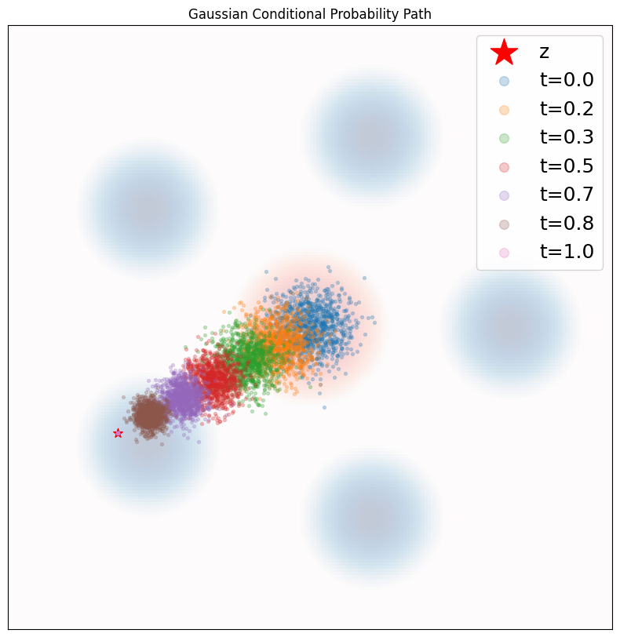

*图 3 · Lab 2，单元格 25。红星是固定 $z$，彩色点是各时刻的条件快照，背景是整个目标混合高斯；末端不是同时覆盖五个模式。*

### Part 2 / Q2.3：求条件速度场并验证 ODE

固定 $z,\epsilon$ 对插值求导，再以 $\epsilon=(x-\alpha_t z)/\beta_t$ 消去噪声：

$$
\begin{aligned}
\frac{dX_t}{dt}&=\dot\alpha_t z+\dot\beta_t\epsilon,\\
u_t^{\rm ref}(x\mid z)&=\dot\alpha_t z+\frac{\dot\beta_t}{\beta_t}(x-\alpha_t z)\\
&=\left(\dot\alpha_t-\alpha_t\frac{\dot\beta_t}{\beta_t}\right)z+\frac{\dot\beta_t}{\beta_t}x.
\end{aligned}
$$

Lab 2 的解析调度给出 $u_t^{\rm ref}(x\mid z)=z-(x-tz)/(2(1-t))$，而实际代码代入的是带 $10^{-4}$ 的 `dt`。`ConditionalVectorFieldODE` 持有固定的 $z$，每步由 `conditional_vector_field(x,z,t)` 计算漂移。验证方式是比较“直接抽的 $p_t(\cdot\mid z)$”与“从单位高斯积分到 $t$ 的粒子分布”。Euler 只评估左端点，网格可以把 1 写成终点，但不能在 $t=1$ 直接调用这个参考场。

### Part 2 / Q2.4：求条件 score 并验证 SDE

由高斯对数密度对 $x$ 求导，归一化常数不贡献梯度：

$$
\begin{aligned}
\log p_t(x\mid z)&=-\frac d2\log(2\pi\beta_t^2)-\frac{\lVert x-\alpha_t z\rVert^2}{2\beta_t^2},\\
s_t(x\mid z)&=\nabla_x\log p_t(x\mid z)=\frac{\alpha_t z-x}{\beta_t^2}
=-\frac{\epsilon}{\beta_t}\quad\text{（在路径样本上）}.
\end{aligned}
$$

把 score 接到原条件速度上：

$$
dX_t=\left[u_t^{\rm ref}(X_t\mid z)+\tfrac12\sigma_t^2 s_t(X_t\mid z)\right]dt+\sigma_t\,dW_t.
$$

为什么保留同样的各时刻分布？令 $q=p_t(\cdot\mid z)$，Fokker–Planck 方程为 $\partial_t q=-\nabla\!\cdot(qu_t^{\rm ref})-\tfrac12\sigma_t^2\nabla\!\cdot(q\nabla\log q)+\tfrac12\sigma_t^2\Delta q$。因 $q\nabla\log q=\nabla q$，后两项相消，回到同一条连续性方程。两种过程可以有相同的单时刻分布，但轨迹不同。这个论证假设在非退化时间内场和密度足够正则，且扩散系数不依赖 $x$。

> **公式与当前代码的区别：** Lab 2 的 `ConditionalVectorFieldSDE.diffusion_coefficient` 和 Q3.2 的 `LangevinFlowSDE.diffusion_coefficient` 都返回 `sigma * torch.randn_like(x)`；`EulerMaruyamaSimulator.step` 又乘了一次独立高斯噪声。结果每个坐标是两个高斯变量的乘积，虽有相同方差，却不是公式所要求的单个高斯增量。标准 EM 的这个接口应返回系数 `sigma * torch.ones_like(x)`，只由积分器抽噪声（和 Lab 1 一样）。因此现有 SDE 图只能作为当前实现的输出，不能当作上式的严格验证。本文不改 Notebook。

### Part 3 / Q3.1：Conditional Flow Matching（CFM）

由 Part 1 可知，边缘速度是条件速度的后验均值，而平方损失的最优回归器正是条件期望。固定 $t$，记随机监督量 $U=u_t^{\rm ref}(X_t\mid Z)$，在二阶矩有限时有：

$$
\begin{aligned}
\mathbb E\lVert f(X_t)-U\rVert^2
&=\mathbb E\lVert f(X_t)-\mathbb E[U\mid X_t]\rVert^2
+\mathbb E\lVert U-\mathbb E[U\mid X_t]\rVert^2.
\end{aligned}
$$

第二项与 $f$ 无关，也是训练损失通常不必趋近 0 的原因。对 $t$ 一起采样，得到可实现的目标：

$$
\mathcal L_{\rm CFM}(\theta)=
\mathbb E_{\substack{t\sim\mathcal U[0,1),\ Z\sim p_{\mathrm{data}}\\ X_t\sim p_t(\cdot\mid Z)}}
\left[\left\lVert u_t^\theta(X_t)-u_t^{\rm ref}(X_t\mid Z)\right\rVert^2\right].
$$

1. **训练：** `ConditionalFlowMatchingTrainer.get_train_loss` 抽 `(z,t)`，直接得到 `x`；`MLPVectorField.forward(x,t)` 拼接位置和时间（二维例子 `3 → 64 → 64 → 64 → 64 → 2`，隐藏层用 SiLU）；参考场用 `(x,z,t)` 计算监督。误差先沿坐标求和，再在 batch 上取均值。`Trainer.train` 每次重新抽样并做一次 Adam 更新；其 `num_epochs` 在这个循环中实际计更新次数。
2. **生成：** 从 `path.p_simple.sample` 抽 $x_0$；`LearnedVectorFieldODE.drift_coefficient(x,t)` 只询问训练好的模型，再由 `EulerSimulator` 推进到末端。生成不传入 $z$，也不调用 `conditional_vector_field`。

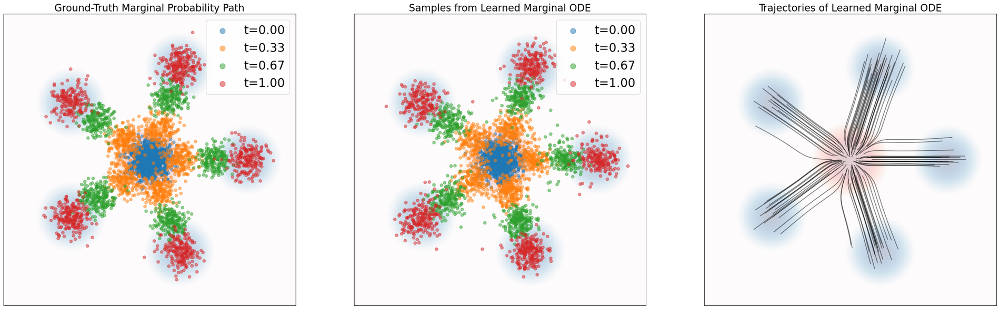

*图 4 · Lab 2，单元格 50。左：解析边缘路径抽样；中：学习的 ODE 样本；右：ODE 轨迹。以样本云是否覆盖五个目标模式和中间状态分布是否接近为读图重点。*

### Part 3 / Q3.2：Conditional Score Matching（CSM）

对 $p_t(x)$ 的边缘化积分求导，使用 $\nabla_xp_t(x\mid z)=p_t(x\mid z)s_t(x\mid z)$，得到：

$$
\begin{aligned}
s_t(x)&=\nabla_x\log p_t(x)=\mathbb E[s_t(X_t\mid Z)\mid X_t=x],\\
\mathcal L_{\rm CSM}(\theta)&=
\mathbb E_{\substack{t\sim\mathcal U[0,1),\ Z\sim p_{\mathrm{data}}\\ X_t\sim p_t(\cdot\mid Z)}}
\left[\left\lVert s_t^\theta(X_t)-\frac{\alpha_t Z-X_t}{\beta_t^2}\right\rVert^2\right].
\end{aligned}
$$

`MLPScore` 与速度 MLP 结构相似但参数独立；`ConditionalScoreMatchingTrainer` 复用路径抽样，把监督换成 `conditional_score`。本作业用的是未加权的批量平方误差。注意 $\mathbb E[\lVert s_t(X_t\mid Z)\rVert^2\mid t]=d/\beta_t^2$，此调度下接近 $t=1$ 的监督量可能很大；理想连续均匀时间下，该监督量的积分二阶矩发散，不能把有限 batch 的损失当作端点已稳定的证据。

`LangevinFlowSDE` 再组合两个预测量，理论对应边缘 SDE：

$$
dX_t=\left[u_t^\theta(X_t)+\tfrac12\sigma^2 s_t^\theta(X_t)\right]dt+\sigma\,dW_t.
$$

只有参考速度与参考 score 都精确、数值和扩散实现正确时，Q2.4 的抵消论证才给出理论路径；使用近似模型时，SDE 与 ODE 的最终样本不会被保证相同。Lab 3 的 CFG 生成主要采用 ODE，不需要这两个 MLP。

### Part 3 / Q3.3：用边缘速度反解边缘 score

高斯条件 score 的后验平均给出 $\alpha_t\mathbb E[Z\mid X_t=x]=x+\beta_t^2 s_t(x)$。代入 Q2.3 的后验平均，得：

$$
\begin{aligned}
u_t^{\rm ref}(x)&=a_t x+b_t s_t(x),\\
a_t&=\frac{\dot\alpha_t}{\alpha_t},\qquad
b_t=\beta_t^2\frac{\dot\alpha_t}{\alpha_t}-\dot\beta_t\beta_t,\\
\widetilde s_t^\theta(x)&=\frac{u_t^\theta(x)-a_t x}{b_t}
=\frac{\alpha_t u_t^\theta(x)-\dot\alpha_t x}{\beta_t^2\dot\alpha_t-\alpha_t\dot\beta_t\beta_t}.
\end{aligned}
$$

`ScoreFromVectorField.forward` 用最后一式，避免在 $\alpha_0=0$ 处直接除以 $\alpha_t$；仍要求其总分母不为 0。Lab 2 **解析**调度在 $0\le t<1$ 的分母是 $1-t/2$，所以 $\widetilde s_t^\theta(x)=(t u_t^\theta(x)-x)/(1-t/2)$。这只是开区间一侧的公式，不能把 $t=1$ 直接代入原始条件 score；**代码**用带偏移的 `SquareRootBeta.dt`，实际分母为 $1-t+\tfrac{t}{2}\tfrac{\sqrt{1-t}}{\sqrt{1-t}+10^{-4}}$，在 $t=1$ 为零。Notebook 对比两个独立参数化的 score 时止于 $t=0.9999$，不是训练第三个网络。

### Part 4 / Q4.1：线性条件路径

现在允许任意可抽样的源分布。给定 $z$，抽 $X_0\sim p_{\mathrm{simple}}$，保持同一个 $X_0$ 时，单条插值轨迹及其速度为：

$$
\begin{aligned}
X_t&=(1-t)X_0+t z,\\
\frac{dX_t}{dt}&=z-X_0,\qquad X_0=\frac{X_t-tz}{1-t},\\
u_t^{\rm ref}(x\mid z)&=\frac{z-x}{1-t}\qquad (t<1).
\end{aligned}
$$

`LinearConditionalProbabilityPath` 的两个方法分别实现插值与速度。若源分布恰有可微的正密度，则变量替换给出 $p_t(x\mid z)=(1-t)^{-d}p_{\mathrm{simple}}((x-tz)/(1-t))$，可由源 score 得到条件 score；但作业只要求源是 `Sampleable`，一般拿不到这个密度梯度，`conditional_score` 因此显式抛异常。对同一对端点，$z-X_0$ 是常数，不意味着不看端点的**边缘**生成轨迹一定是一条直线。

### Part 4 / Q4.2：用线性路径训练 Flow Matching

固定 $z$ 的验证先对照直接采样与 ODE 模拟，再看重抽 $z$ 的边缘路径。正式实验把标准二维高斯映到棋盘格：只替换 `path`，沿用 CFM 的 `get_train_loss`、MLP 和 Euler 生成。解析路径快照与学习路径的匹配只是定性检验，不需要为棋盘格计算 score。

### Part 4 / Q4.3：任意源和目标之间的桥接

将源换成 `CirclesSampleable`、目标仍用 `CheckerboardSampleable`；`MoonsSampleable` 也可用于探索。独立抽取两端意味着这不是在做最优配对或显式求最佳传输；本题验证的是两端可由抽样接口指定、同一套 CFM 仍可工作。

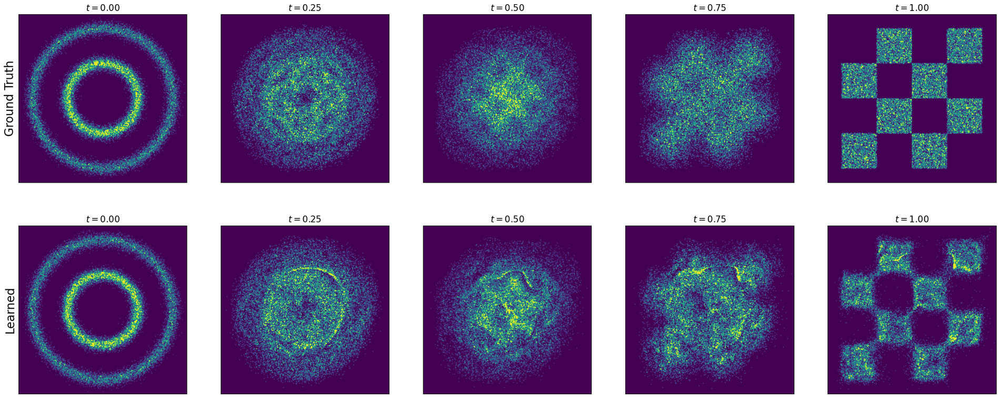

*图 5 · Lab 2，单元格 78。上排是直接构造的边缘路径，下排是学习速度后的 Euler 模拟。从左到右为 $t=0,0.25,0.5,0.75,1$。末列复现了棋盘格的大致结构，但和参考格子在边界、密度上有差异。*

<a id="lab-3"></a>

## Lab 3：A Conditional Generative Model for Images

### Part 0：复用路径、积分器与训练器

`LabeledSampleable.sample(B)` 返回 `(样本, 类别)`。`IsotropicGaussian` 按指定的单样本形状抽噪声；同一套高斯路径因而支持二维点、图像或空间隐变量。路径使用 `(B,)` 时间输入，评估调度后扩展为 `(B,1,1,1)` 以广播到图像。积分器允许把 `y` 通过 `**kwargs` 原样传给漂移；图像可视化传入 `(B,T,1,1,1)` 的时间网格，使用 `ts[:,k]`，Euler 将步长 reshape 到可广播形状，模型的时间编码则把 $t$ 展平成每个样本一个值。

训练框架换用 AdamW（`weight_decay=1e-4`），默认前 500 步做线性 warmup：第 $k$ 步（从 0 数）学习率为 $\mathrm{lr}\,\min\{(k+1)/500,1\}$。基类负责更新循环，子类定义损失和 checkpoint；定期保存而非保证最后一步保存。

### Part 1：查看 MNIST 并构造带噪路径

`MNISTSampler` 从训练集做批内无放回随机抽样。每张图 resize 到 `32×32`，转张量后做 $(v-0.1305)/0.2891$；返回 `(B,1,32,32)` 图像及 `(B,)` 整型标签。此处 `LinearAlpha` 和 `LinearBeta` 给出 $\alpha_t=t,\dot\alpha_t=1,\beta_t=1-t,\dot\beta_t=-1$。代入 Lab 2 的一般公式：

$$
\begin{aligned}
X_t &= t z+(1-t)\epsilon,\qquad \epsilon\sim\mathcal N(0,I),\\
u_t^{\rm ref}(x\mid z)&=z-\frac{x-tz}{1-t}=\frac{z-x}{1-t},\\
s_t(x\mid z)&=\frac{tz-x}{(1-t)^2},\qquad t<1.
\end{aligned}
$$

在同一个插值样本上，参考速度也等于 $z-\epsilon$。它不需要随时间改变，但代码经由 $(x,z,t)$ 反解，仍不能直接在 $t=1$ 求值。这里与 Lab 2 的线性插值等价，但起点固定为单位高斯；模型最终回归的是**速度**而不是 $\epsilon$ 或 $z$。

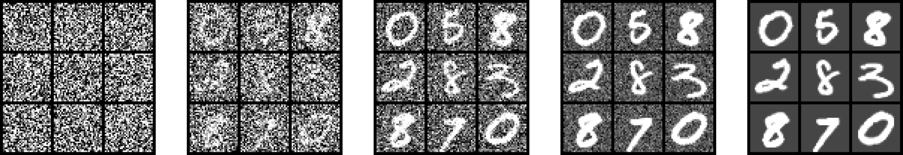

*图 6 · Lab 3，单元格 23。五组分别为 $t=0,0.25,0.5,0.75,1$，各组复用真实图像 $z$，但重新抽噪声，因此展示的是分布快照。*

### Part 2：Classifier-Free Guidance（CFG）的推导

标签 $y$ 条件下，$p_t(x\mid y)=\int p_t(x\mid z)\,p_{\mathrm{data}}(dz\mid y)$，精确的类别条件速度是 $\mathbb E[u_t^{\rm ref}(X_t\mid Z)\mid X_t=x,Y=y]$。Lab 2 的系数 $(a_t,b_t)$ 也适用于这条类别条件路径；贝叶斯公式给出：

$$
\begin{aligned}
\nabla_x\log p_t(x\mid y)&=\nabla_x\log p_t(x)+\nabla_x\log p_t(y\mid x),\\
u_t(x\mid y)-u_t(x)&=b_t\nabla_x\log p_t(y\mid x),\\
\widetilde u_t^\theta(x\mid y)&=u_t^\theta(x\mid\varnothing)
+w\big[u_t^\theta(x\mid y)-u_t^\theta(x\mid\varnothing)\big]\\
&=(1-w)u_t^\theta(x\mid\varnothing)+w u_t^\theta(x\mid y).
\end{aligned}
$$

`CFGVectorFieldODE.drift_coefficient` 用同一个网络分别评估真实标签与空标签，再组合结果。按本作业的约定，$w=0$ 是无条件，$w=1$ 是原条件速度，$w>1$ 是沿“类别相对无条件”的方向外推，而非凸平均。它不需要单独的分类器；较大 $w$ 可能提高类别辨识度，也可能降低多样性或放大模型误差，不能从样本图直接得出定量结论。如果输入本身就是空标签，两次预测相同，引导项消失。

### Part 2 / Q2.2：训练同时具备条件和无条件能力的网络

用独立的 $M\sim\mathrm{Bernoulli}(\eta)$ 丢弃标签，记 $\bar Y=\varnothing$ 当 $M=1$，否则 $\bar Y=Y$。对 MNIST，数字 `0…9` 加空标签 `10`，共 11 个 embedding。改变的是标签，不是图像或速度监督：

$$
\mathcal L_{\mathrm{CFG}}(\theta)=
\mathbb E_{\substack{(Z,Y)\sim p_{\mathrm{data}},\ M\sim\mathrm{Bernoulli}(\eta)\\
t\sim\mathcal U[0,1-\varepsilon),\ X_t\sim p_t(\cdot\mid Z)}}
\left[\left\lVert u_t^\theta(X_t\mid\bar Y)-u_t^{\rm ref}(X_t\mid Z)\right\rVert^2\right].
$$

`CFGTrainer.get_train_loss` 按“抽 $(z,y)$ → 独立丢标签 → 抽 `t`（默认 $\varepsilon=0.001$）→ 构造 `x` → 算参考速度及网络输出 → `.square().mean()`”执行。这里是按所有坐标与 batch 取均值，与 Lab 2 的“坐标先求和”只差固定维度的归一化，但数值不能直接对比。训练时不混合条件／无条件两路预测，也不用 $w$；$\eta$ 只控制训练数据中的空标签比例。

### Part 2 / Q2.3 与 Sanity Check 2.4：先用二维 GMM 验证

`MLPConditionalVectorField.forward` 拼接 `x`、`t` 和类别 embedding，经过两层 SiLU 隐藏层，再输出与 `x` 同形的速度。作业用 `GMM.sample` 给每个点附上混合分量索引（真实标签 `0…2`，空标签 `3`），在便宜的二维问题上检验条件分支和空标签分支，再换为图像架构。

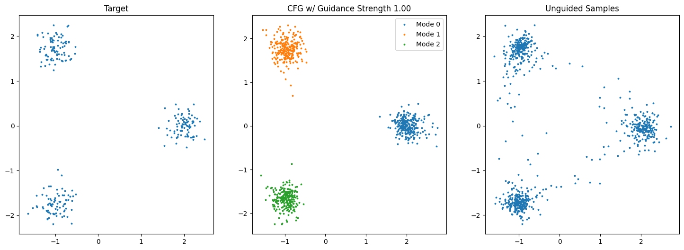

*图 7 · Lab 3，单元格 37。左为真实混合高斯，中为按指定分量采样（这里 $w=1$），右为空标签生成的整体分布。中图按类别着色，不是在比较三个不同引导强度。*

### Part 3 / Q3.1：Fourier 时间编码

设隐藏宽度 $D$ 为偶数，`FourierEncoder` 有 $D/2$ 个按标准正态初始化、随后可学习的频率 $\omega_i$：

$$
f_i(t)=2\pi\omega_i t,\qquad
e_t=\sqrt2\,[\sin f_1(t),\ldots,\sin f_{D/2}(t),\cos f_1(t),\ldots,\cos f_{D/2}(t)]\in\mathbb R^D.
$$

时间编码与类别 embedding 同宽，模型使用 $c_{t,y}=e_t+E[y]$，而不是把两个条件拼成额外 token。`D=256` 时每个样本的时间向量包含 128 个正弦与 128 个余弦分量。

### Part 3 / Q3.2：Patchifier

输入 `(B,C,H,W)`；`Conv2d(C,D,kernel_size=p,stride=p)` 每次覆盖一个不重叠 patch，相当于把每个长度 $Cp^2$ 的向量映射到 $D$ 维。展开空间网格得到 `(B,N,D)`，其中 $N=(H/p)(W/p)$。Notebook 的构造器针对边长统一为 `img_size` 的方形输入，并要求边长可整除 $p$。

### Part 3 / Q3.3：Diffusion Transformer（DiT）

**自注意力。** `MHA` 用一个线性层生成 $(Q,K,V)$，按 $H_a$ 个头切分，头宽 $d_h=D/H_a$，要求 $D$ 可整除头数。每头内在 token 维度归一化：

$$
A_j=\operatorname{softmax}_{\rm keys}\!\left(\frac{Q_jK_j^\top}{\sqrt{d_h}}\right),\qquad
\operatorname{MHA}(X)=W_O\operatorname{Concat}_{j=1}^{H_a}(A_jV_j)+b_O.
$$

**条件调制与残差。** `DiffusionTransformer` 先加可学习的位置参数 $P\in\mathbb R^{N\times D}$。每层单独将条件 $c=c_{t,y}$ 经 `RMSNorm → Linear(D,6D)` 投影为两组三元组 $(s_a,b_a,g_a;s_f,b_f,g_f)$ 并广播到所有 token。这里归一化实际使用无仿射 `RMSNorm`，即 $\operatorname{RN}(v)=v/\sqrt{D^{-1}\sum_i v_i^2+\epsilon_{\rm norm}}$；代码变量名 `ada_ln` 不等于实际用了 LayerNorm。定义 $\operatorname{mod}(v,s,b)=v\odot(1+s)+b$ 后：

$$
\begin{aligned}
X' &= X+g_a\odot\operatorname{MHA}\!\left(\operatorname{mod}(\operatorname{RN}_1(X),s_a,b_a)\right),\\
X''&=X'+g_f\odot\operatorname{MLP}_{D\to4D\to D}\!\left(\operatorname{mod}(\operatorname{RN}_2(X'),s_f,b_f)\right).
\end{aligned}
$$

条件投影的权重和偏置零初始化，因此初始门值 $g_a,g_f$ 都为零，**每个残差层从恒等映射起步**；这不代表包括 patch 投影、位置参数和输出头在内的整个模型都恒等。条件通过 scale、bias、gate 进入各层，不是通过 cross-attention。

### Part 3 / Q3.4：Depatchifier

`Depatchifier` 对 `(B,N,D)` 的 token 做 `RMSNorm → MLP(D,4D,Fp²)`。每个 token 重新解释为 `(F,p,p)`，按原 patch 网格拼成 `(B,F,H,W)`，最后由 `Conv2d(F,C,3,padding=1)` 输出与输入同形的速度。$F$ 是中间特征数（作业用 10），不是类别数，也不是输出通道数。

### Part 3 / Q3.5：组装像素空间速度模型

```text
x_t (B,1,32,32) → Patchifier (B,64,256) → 加位置编码 → DiT × 8
t → FourierEncoder ─┐                                      │
y → Embedding ───────┴→ 相加 (B,256) → 逐层调制、门控 ────────┘
DiT (B,64,256) → Depatchifier (B,10,32,32) 的中间特征 → (B,1,32,32) 速度
```

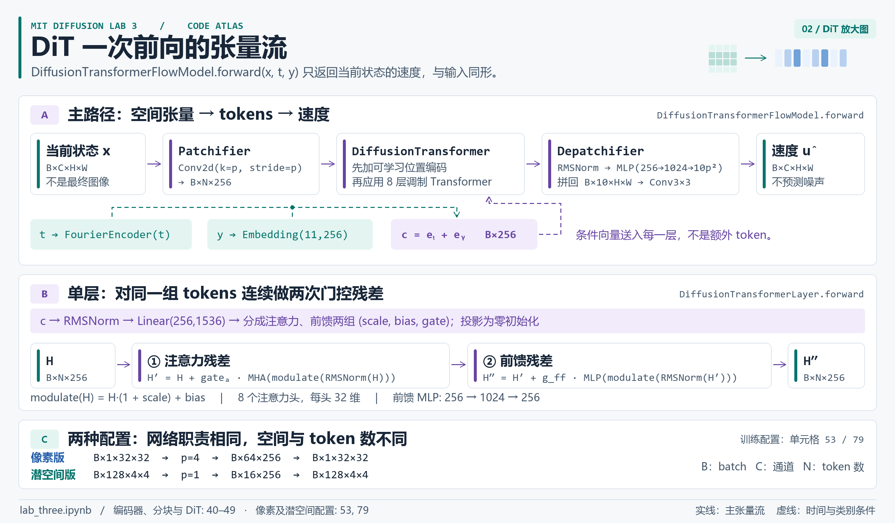

*架构图 A · 实线是空间张量和 token 的主路径，虚线是时间、标签条件。图底部并排对照像素版与潜空间版的实际配置。[SVG 矢量版](docs/assets/diffusion-labs/lab3-dit-forward.svg)*

实际训练参数是 $p=4,D=256,H_a=8$、8 层，故 64 个 token、每头 32 维；类表大小为 11。`DiffusionTransformerFlowModel.forward` 仅输出速度；`MNISTCFGTrainer` 复用像素 CFG 训练损失，替换 checkpoint 回调。Notebook 记录训练 20,000 次更新（batch 256，`lr=4e-4`，$\eta=0.35$）。

**推理**：选数字标签和 $w$，抽 $x_0\sim\mathcal N(0,I)$，`CFGVectorFieldODE` 每步产生 $\widetilde u$，`EulerSimulator` 执行 $x_{k+1}=x_k+h_k\widetilde u_{t_k}^\theta(x_k\mid y)$。`visualize_output` 默认用 100 个时间点（99 次更新）到 $0.999$，展示 $w=1,3,5$。网格按每个引导面板做最小值／最大值归一化，且当前实现每个面板会重抽初值，不是对每一张图做同噪声配对比较。

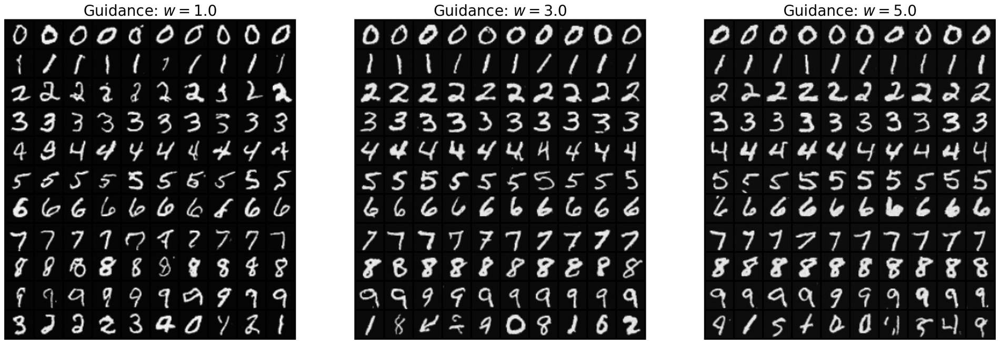

*图 8 · Lab 3，单元格 55 的训练后采样。每个面板从上到下是 `0…9`，末行是空标签；列来自不同样本。观察类别是否对齐、同类是否仍有变化。*

### Part 4：训练 VAE，定义潜空间

编码器与解码器都输出一张**均值张量**和一个**全局可学习标量 log-variance**。设 $\ell_z=\log\sigma_z^2$、$\ell_x=\log\sigma_x^2$，将两个张量按坐标展开后，概率模型是：

$$
\begin{aligned}
q_\phi(z_{\rm lat}\mid x)&=\mathcal N\!\left(\mu_\phi(x),e^{\ell_z}I\right), & p(z_{\rm lat})&=\mathcal N(0,I),\\
p_\psi(x\mid z_{\rm lat})&=\mathcal N\!\left(\mu_\psi(z_{\rm lat}),e^{\ell_x}I\right), &
z_{\rm lat}&=\mu_\phi(x)+e^{\ell_z/2}\epsilon,\quad\epsilon\sim\mathcal N(0,I).
\end{aligned}
$$

重参数化把随机性放入独立的 $\epsilon$，使梯度能穿过均值和 log-variance。这里的 log-variance 不是标准差、不是 log-standard-deviation，也不是逐样本预测出来的张量。

#### Q4.1：ResidualBlock

`GroupNorm(1,C) → Conv3×3 → SiLU → Conv1×1 → 加输入`，即

$$
r(x)=x+\operatorname{Conv}_{1\times1}\bigl(\operatorname{SiLU}(\operatorname{Conv}_{3\times3}(\operatorname{GN}(x)))\bigr).
$$

尺寸和通道数不变。最后的 `Conv1×1` 零初始化，保证这个块初始为恒等映射；这里的单组 GroupNorm 是按每个样本的通道与空间元素归一化。

#### Q4.2：AttnBlock

先将 `(B,C,H,W)` 展平为 `(B,HW,C)`，做 `LayerNorm → 单头 MHA → 残差相加`，再做 `LayerNorm → MLP(C,2C,C) → 残差相加`，最后恢复图像形状。写成 $T'=T+\operatorname{MHA}(\operatorname{LN}_1(T))$ 与 $T''=T'+\operatorname{MLP}(\operatorname{LN}_2(T'))$。此处无时间／类别调制，不是上面的 DiT 层；前馈末层零初始化，但注意力分支不是零门控。

#### Q4.3：EncoderBlock

`ResidualBlock × 2 → AttnBlock → 可选下采样`。下采样是 `Conv3×3(stride=2,padding=1)`，在本作业的偶数边长上将高、宽减半，并将通道改为下一层要求的通道；最后一块不再下采样。

#### Q4.4：Encoder

初始 `Conv3×3` 把输入通道 1 映射到 16；串联四个 EncoderBlock；最后 `GroupNorm → Conv1×1` 输出 `z_mean`，另返回从 0 初始化的标量 `logvar`：

```text
(B,1,32,32) → (B,16,32,32) → (B,32,16,16) → (B,64,8,8) → (B,128,4,4)
→ 第四块保持形状 → 均值头 (B,128,4,4) + 标量 ℓ_z
```

#### Q4.5：DecoderBlock

`ResidualBlock × 2 → AttnBlock → 可选上采样`。上采样用最近邻放大 2 倍，再用带 padding 的 `Conv3×3` 改通道，不用转置卷积；最后一块不再上采样。

#### Q4.6：Decoder

以倒序通道 `[128,64,32,16]` 串联四个 DecoderBlock，再用 `GroupNorm → Conv1×1` 输出 `x_mean` 与独立标量 `x_logvar`：

```text
(B,128,4,4) → (B,64,8,8) → (B,32,16,16) → (B,16,32,32)
→ 第四块保持形状 → 均值头 (B,1,32,32) + 标量 ℓ_x
```

<a id="vae-elbo"></a>

#### Q4.7：从边缘似然推导 ELBO，再对照实际损失

以下简写 $z=z_{\rm lat}$，$d_x,d_z$ 分别是展开后的图像和潜变量维度。解码器参数为 $\psi$，编码器参数为 $\phi$。

##### 1. 为什么需要编码器？

生成模型先采 $z\sim p(z)$，再采 $x\sim p_\psi(x\mid z)$。只观测到图像 $x$，没有观测到它对应的 $z$，所以训练真正想提高的是图像的**边缘对数似然**（log evidence），需要把所有可能的 $z$ 积分掉：

$$
p_\psi(x,z)=p(z)p_\psi(x\mid z),\qquad
p_\psi(x)=\int p_\psi(x\mid z)p(z)\,dz,\qquad
p_\psi(z\mid x)=\frac{p(z)p_\psi(x\mid z)}{p_\psi(x)}.
$$

先验 $p(z)$ 很好采样。但解码器的均值 $\mu_\psi(z)$ 是非线性网络，即使先验和解码器观测噪声都是高斯，真实后验 $p_\psi(z\mid x)$ 一般也不是高斯，分母通常没有解析解。编码器 $q_\phi(z\mid x)$ 是我们选定的、可采样可求密度的近似。每张图使用同一套参数 $\phi$，一次前向就给出各自的近似后验，而不为每张图单独求解，这叫**摊销变分推断**。

##### 2. Jensen 不等式与下界差距

在本题的非退化高斯设定中，可在积分内乘除同一个 $q_\phi(z\mid x)$。因为 $\log$ 是凹函数，$\log\mathbb E[R]\geq\mathbb E[\log R]$：

$$
\begin{aligned}
\log p_\psi(x)
&=\log\mathbb E_{q_\phi(z\mid x)}\!\left[\frac{p(z)p_\psi(x\mid z)}{q_\phi(z\mid x)}\right]\\
&\geq \mathbb E_{q_\phi(z\mid x)}\!\left[\log p_\psi(x\mid z)+\log\frac{p(z)}{q_\phi(z\mid x)}\right]\\
&=\underbrace{\mathbb E_{q_\phi(z\mid x)}[\log p_\psi(x\mid z)]}_{\text{重建对数似然}}
-\underbrace{D_{\rm KL}\bigl(q_\phi(z\mid x)\|p(z)\bigr)}_{\text{对先验的 KL}}
\;=:\;\mathcal L_{\rm ELBO}(x;\psi,\phi).
\end{aligned}
$$

这就是 ELBO（Evidence Lower Bound，对数证据的下界）。还可以用 Bayes 公式求出下界到底差多少：

$$
\begin{aligned}
D_{\rm KL}\bigl(q_\phi(z\mid x)\|p_\psi(z\mid x)\bigr)
&=\mathbb E_{q_\phi(z\mid x)}\!\left[\log q_\phi(z\mid x)-\log p_\psi(x,z)+\log p_\psi(x)\right]\\
&=\log p_\psi(x)-\mathcal L_{\rm ELBO}(x;\psi,\phi)\;\geq\;0.
\end{aligned}
$$

**两种 KL 不能混淆。** 对真实后验的 KL 是**下界差距**：若 $q_\phi=p_\psi(\cdot\mid x)$，下界就等于对数似然；固定解码器时，优化编码器只会收紧这个下界。对先验的 KL 是 **ELBO 中实际可算的正则项**，它为零不代表下界取等号。实现中最小化的是负目标；$\beta_{\rm VAE}=1$ 对应标准负 ELBO，改变权重后是 KL 加权目标，不再是原推导得到的标准 ELBO：

$$
\mathcal J_{\beta}(x)=\mathbb E_{q_\phi(z\mid x)}[-\log p_\psi(x\mid z)]
+\beta_{\rm VAE}\,D_{\rm KL}\bigl(q_\phi(z\mid x)\|p(z)\bigr).
$$

当 $\beta_{\rm VAE}\geq1$ 时，$-\mathcal J_\beta$ 在标准 ELBO 上又减去了一个非负项，所以仍是下界，但一般更松；$\beta_{\rm VAE}<1$ 时则不保证仍是下界。这个比较针对理论目标，实际代码还会改变归一化方式（见第 5 小节）。

**手算例子。** 设一维 $Z\sim\mathcal N(0,1)$、$X\mid Z=z\sim\mathcal N(z,1)$，所以 $X=Z+\nu$，独立噪声 $\nu\sim\mathcal N(0,1)$。边缘为 $\mathcal N(0,2)$；由 $z^2+(x-z)^2=2(z-x/2)^2+x^2/2$ 可读出真实后验 $\mathcal N(x/2,1/2)$。固定 $x=1$，精确值为 $\log p(1)=-\tfrac12\log(4\pi)-\tfrac14\approx-1.5155$。用下文的高斯公式计算两种 $q$：

| 编码器取什么分布 | 重建对数似然的期望 | 对先验的 KL | ELBO | 与精确对数似然的差距 |
|---|---:|---:|---:|---:|
| $q=p(z)=\mathcal N(0,1)$ | $-1.9189$ | $0$ | $-1.9189$ | $0.4034$ |
| $q=p(z\mid x=1)=\mathcal N(1/2,1/2)$ | $-1.2939$ | $0.2216$ | $-1.5155$ | $0$ |

表中重建项为 $-\tfrac12\bigl(\log(2\pi)+\mathbb E_q[(1-Z)^2]\bigr)$，两行的平方残差期望分别为 $2$ 和 $3/4$。第一行的先验 KL 更低，ELBO 却更松；第二行用更好的重建抵消了正的先验 KL，并且因为选对后验而取到等号。

##### 3. 重参数化：梯度怎样通过随机样本？

令 $g_\phi(x,\epsilon)=\mu_\phi(x)+e^{\ell_z/2}\epsilon$，其中 $\epsilon\sim\mathcal N(0,I)$ 不依赖编码器参数。对单张图像，把重建负对数似然写作 $f_x(z)=-\log p_\psi(x\mid z)$：

$$
\mathbb E_{q_\phi(z\mid x)}[f_x(z)]
=\mathbb E_{\epsilon\sim\mathcal N(0,I)}[f_x(g_\phi(x,\epsilon))]
\approx \frac{1}{K}\sum_{k=1}^K f_x\bigl(g_\phi(x,\epsilon^{(k)})\bigr).
$$

反向传播时视本次抽到的 $\epsilon$ 为常量，则 $\partial z_j/\partial\mu_{\phi,j}=1$，$\partial z_j/\partial\ell_z=\tfrac12 e^{\ell_z/2}\epsilon_j$；重建梯度便能沿 `decode(z) → z → z_mean, z_logvar` 回到编码器。`VAE.forward` 对每张图使用 $K=1$，而不是只解码均值；均值和方差仍可通过 batch 梯度共同学习。下面的先验 KL 可以解析求值，不需要对它重复抽样。可对照 Kingma 与 Welling 的 *Auto-Encoding Variational Bayes*（ICLR 2014，arXiv:1312.6114）§2 与附录 B。

##### 4. 高斯重建项和先验 KL 从哪里来？

**重建项。** $p_\psi(x\mid z)$ 是各向同性高斯，取负对数后，指数部分产生平方残差，归一化常数产生 log-variance 项：

$$
-\log p_\psi(x\mid z_{\rm lat})
=\tfrac12\sum_{i=1}^{d_x}\bigl[(x_i-\mu_{\psi,i}(z))^2e^{-\ell_x}+\ell_x+\log(2\pi)\bigr].
$$

若 $\ell_x$ 固定，重建项和 MSE 只差尺度及常数；若 $\ell_x$ 可学，就必须保留 $\ell_x$ 项，否则增大方差即可人为减小加权残差。忽略代码中分母的 $10^{-6}$，固定一组重建结果，设 $R>0$ 为平均平方残差，则重建项关于 $\ell_x$ 的可变部分正比于 $Re^{-\ell_x}+\ell_x$；令导数 $-Re^{-\ell_x}+1=0$，得到最优方差 $e^{\ell_x}=R$。这也说明 `x_logvar` 是一个在样本和像素之间共享的残差尺度，不是对每个像素单独预测置信度。

**先验 KL。** 展开 $\mathbb E_q[\log q_\phi(z\mid x)-\log p(z)]$。两个高斯的 $\log(2\pi)$ 项相消，且对编码器第 $j$ 个坐标有 $\mathbb E_q[(Z_j-\mu_{\phi,j})^2]=e^{\ell_z}$、$\mathbb E_q[Z_j^2]=\mu_{\phi,j}^2+e^{\ell_z}$，于是

$$
\begin{aligned}
D_{\rm KL}\bigl(q_\phi(z\mid x)\|p(z)\bigr)
&=\tfrac12\sum_{j=1}^{d_z}\mathbb E_q\!\left[Z_j^2-\ell_z-(Z_j-\mu_{\phi,j})^2e^{-\ell_z}\right]\\
&=\tfrac12\sum_{j=1}^{d_z}\bigl[\mu_{\phi,j}^2+e^{\ell_z}-\ell_z-1\bigr].
\end{aligned}
$$

其中 $\mu_{\phi,j}^2$ 惩罚均值远离 0；$e^{\ell_z}-\ell_z-1\geq 0$ 在 $\ell_z=0$ 时取最小值，惩罚方差偏离 1。训练时重建项要求 $z$ 保留图像信息，KL 则限制编码和标准高斯相差太远；只最小化其中一项得不到这种平衡。

##### 5. 对照 `VAE.compute_loss`：代码里的 `beta=10` 如何理解？

Notebook 去掉常数项和共同的 $1/2$，对重建和 KL 各自的坐标与 batch **分别**取均值，并在重建的方差分母加 $10^{-6}$：

$$
\begin{aligned}
L_{\rm recon}^{\rm code}
&=\operatorname{mean}_{B,d_x}\left[\frac{(x-\mu_\psi)^2}{e^{\ell_x}+10^{-6}}+\ell_x\right],\\
L_{\rm KL}^{\rm code}
&=\beta_{\rm VAE}\operatorname{mean}_{B,d_z}\left[\mu_\phi^2+e^{\ell_z}-\ell_z-1\right],\qquad
L^{\rm code}=L_{\rm recon}^{\rm code}+L_{\rm KL}^{\rm code}.
\end{aligned}
$$

| 代码变量 | 数学含义 | 在目标里的作用 |
|---|---|---|
| `z_mean`, `z_logvar` | $\mu_\phi(x)$、标量 $\ell_z$ | 决定后验抽样，也进入先验 KL。 |
| `x_mean`, `x_logvar` | $\mu_\psi(z)$、标量 $\ell_x$ | 决定重建均值与高斯观测方差。 |
| `mse_term`, `confidence_term` | 按方差加权的平方残差、$\ell_x$ | 相加再取均值，对应高斯重建负对数似然的可变部分。 |
| `kl_loss` | `beta` 乘逐坐标 KL 表达式的均值（无 $1/2$） | 约束的是近似后验与标准高斯先验，不是直接拟合真实后验。 |

忽略 $10^{-6}$ 及与参数无关的常数，令 $\overline{\rm NLL}$、$\overline{\rm KL}$ 表示**先按维求和再对 batch 取均值**的理论项（均含 $1/2$；NLL 用一次抽样估计），则

$$
L^{\rm code}\;=\;\frac{2}{d_x}\left(\overline{\rm NLL}+\beta_{\rm VAE}\frac{d_x}{d_z}\,\overline{\rm KL}\right)+\mathrm{const}.
$$

因此，$d_x=1\cdot32\cdot32=1024$、$d_z=128\cdot4\cdot4=2048$ 时，代码的 `beta=10` 相当于**按维求和目标中 KL 权重为 5**（按上述近似），而不是 10。`MNISTVAETrainer` 不用标签；局部变量 `z_std`、`x_std` 实际仍是 log-variance。单元格 74 使用 `beta=10`、batch 64，训练 5,000 次更新。重建图显示解码均值，而不是再加观测噪声。总损失为负并不矛盾：代码包含可为负的 $\ell_x$，且连续概率密度可大于 1，因而其负对数似然不必非负。

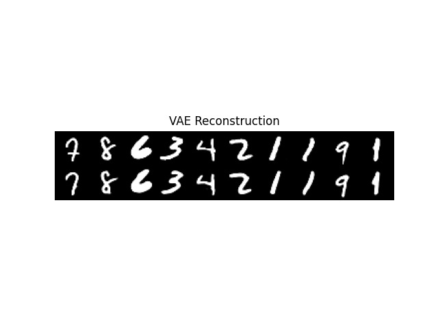

*图 9 · `runs/dark-jackfruit-1b58203b` 的步号 4750。上排为输入，下排为从抽样隐变量解码得到的图像均值。*

`visualize_latent_interpolation` 对两张图分别抽取 $z_a,z_b$，构造 $z(\lambda)=(1-\lambda)z_a+\lambda z_b$（$\lambda\in[0,1]$），然后解码成连续的重建结果。这是 VAE 潜空间几何的示例，不是对时间速度场做 ODE 积分。

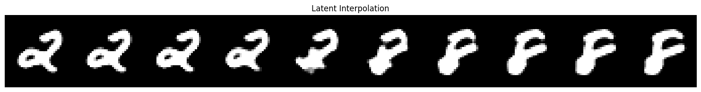

*图 10 · Lab 3，单元格 75。十张图对应从一个编码样本到另一个编码样本的线性插值。*

<a id="vae-aggregate-posterior"></a>

##### 补充：编码器后验、聚合后验、先验有什么不同？

对固定的 $x$，$q_\phi(z\mid x)$ 是编码一个样本后的分布；若先从数据集中抽 $X$，再按编码器抽 $Z$，得到的是**聚合后验** $q_{\rm agg}(z)$。记 $q_\phi(x,z)=p_{\rm data}(x)q_\phi(z\mid x)$，则

$$
q_{\rm agg}(z)=\int q_\phi(z\mid x)\,p_{\rm data}(dx),\qquad
q_{\rm agg}(z\mid y)=\int q_\phi(z\mid x)\,p_{\rm data}(dx\mid y).
$$

对先验的训练 KL 可以进一步分解。把 $\log(q_\phi(z\mid x)/p(z))$ 拆成 $\log(q_\phi(z\mid x)/q_{\rm agg}(z))+\log(q_{\rm agg}(z)/p(z))$，在上述联合分布下取期望：

$$
\mathbb E_{p_{\rm data}(x)}D_{\rm KL}\bigl(q_\phi(z\mid x)\|p(z)\bigr)
= \underbrace{I_{q_\phi}(X;Z)}_{\text{潜变量保留的输入信息}}
+ \underbrace{D_{\rm KL}\bigl(q_{\rm agg}(z)\|p(z)\bigr)}_{\text{聚合分布与先验的差异}}.
$$

这个分解可对照 Hoffman 与 Johnson 的 *ELBO Surgery*（2016）§3。左边的惩罚同时作用于这两部分，但不保证聚合后验恰好等于先验；若编码器对所有图都输出同一个先验，KL 为零，$Z$ 也不再携带关于 $X$ 的信息。这是**后验坍塌**的典型形式，不代表本次实验一定发生了坍塌。

读图与采样时可区分三个操作：**重建**从给定图像的 $q_\phi(z\mid x)$ 抽样后解码；**原始 VAE 无条件生成**从 $p(z)=\mathcal N(0,I)$ 直接抽样后解码；**Part 5 的潜空间生成**也从标准高斯出发，但先用速度模型把分布推向编码样本的目标分布，再解码。后一种做法能利用拟合的潜空间分布及类别结构，不需要假设编码完的样本已经服从标准高斯。

### Part 5 / Q5.1：在潜空间训练 CFG 速度模型


*架构图 B · 图中箭头按张量流向绘制。推理时的调用方向是 `EulerSimulator.step` → `CFGVectorFieldODE.drift_coefficient` → 对同一个 DiT 做两次前向；拿到合成速度后，Euler 才更新状态，最后一次更新后的潜张量才交给 VAE 解码。[SVG 矢量版](docs/assets/diffusion-labs/lab3-vae-cfg-dit-flow.svg)*

只改变生成发生的空间，不改变 CFM 的原理。将 MNIST 图像 $x$ 先编码成**后验抽样**的终点，而不只取均值：

$$
\begin{aligned}
z_\bullet &= \mu_\phi(x)+e^{\ell_z/2}\epsilon_{\rm enc},\qquad \epsilon_{\rm enc}\sim\mathcal N(0,I),\\
Z_t &= t z_\bullet+(1-t)\epsilon_{\rm path},\qquad \epsilon_{\rm path}\sim\mathcal N(0,I),\\
v_t^{\rm ref}(Z_t\mid z_\bullet) &= \frac{z_\bullet-Z_t}{1-t}=z_\bullet-\epsilon_{\rm path},\\
L^{\rm latent}&=\mathbb E\left[\operatorname{mean}_{d_z}\!\left((v_t^\theta(Z_t\mid\bar Y)-v_t^{\rm ref}(Z_t\mid z_\bullet))^2\right)\right].
\end{aligned}
$$

两处噪声是独立抽样：一处采 VAE 后验，一处构造 Flow Matching 的路径。期望覆盖真实 $(x,y)$、编码噪声、标签替换、$t\sim\mathcal U[0,0.999)$ 和路径噪声。真实标签对应的参考路径以[类条件聚合后验](#vae-aggregate-posterior)为终点，空标签则对应不区分类别的聚合后验；它们都与推理时的单位高斯起点不同。代码把 `vae.encode` 和后验采样放在 `torch.no_grad()` 中，优化器只更新潜空间 DiT。

```text
训练：MNIST(x,y) → VAE encoder（不更新）→ 采 z_● → 构造 Z_t 和参考速度
                           标签以 η 丢弃 → DiT(Z_t,t,ȳ) → 速度 MSE → 更新 DiT

生成：指定 y 和 w → 抽 z_0 ~ N(0,I) → CFG + Euler 积分 → z_final
                                                      → VAE decoder → x_mean
```

`GaussianConditionalProbabilityPath(p_data=None)` 在这里仅提供起点、插值和参考场，不会从 `p_data` 抽样。`LatentCFGTrainer.get_train_loss` 从 `mnist.sample` 取数据；`visualize_samples` 从 `path.p_simple.sample` 取噪声、求解潜空间 ODE、再用 `vae.decode` 得到图像均值。作业采用 `128×4×4` 潜张量、`patch_size=1`，即 16 个 token；其余 DiT 主体与像素模型相同（8 层、宽 256、8 头）。**空间网格变小不等于标量总数减少**：像素有 1024 个坐标，潜张量有 2048 个；本例的注意力节省来自 token 从 64 减到 16，每头的注意力矩阵从 $64^2$ 降到 $16^2$，不是把整个模型的开销降低同样倍数。

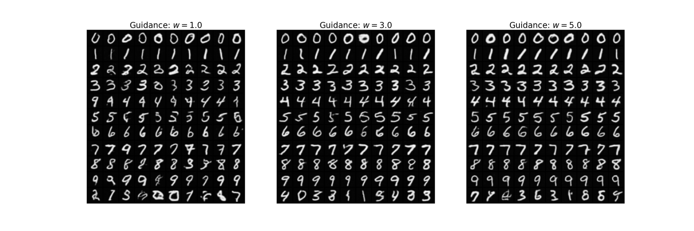

*图 11 · `runs/cool-cantaloupe-7ed2b970` 的步号 9500（Notebook 保存的日志记录了 10,000 次更新）。行与引导系数的读法同图 8。此图展示“标准高斯 → 潜空间 DiT → VAE 解码”的最终图像，不是潜变量热图。*

| Lab 3 阶段 | 模型预测或重建的对象 | Notebook 记录的更新次数 / batch | 要观察什么 |
|---|---|---|---|
| 像素 DiT | `1×32×32` 的像素速度 | 20,000 / 256 | 生成的行是否对齐标签，且同类样本是否有变化。 |
| VAE | 后验与重建的均值、各自的标量 log-variance | 5,000 / 64 | 重建是否保留笔画和类别，插值是否平滑。 |
| 潜空间 DiT | `128×4×4` 的潜速度 | 10,000 / 256 | 经解码后是否保留类别和笔画结构。 |

这些是不同坐标系或不同目标下的损失，不能直接拿绝对数值比较生成质量；样本图也不是固定噪声、固定评估集下的定量对照。

<a id="code-map"></a>

## 组件、公式与函数对照

### Lab 1：数值积分与已知动力学

| 作业位置 | 数学或流程职责 | Notebook 组件及入口（单元格） |
|---|---|---|
| Part 0–1 / Q1.1 | 将系数定义与数值积分分开 | `ODE.drift_coefficient`、`SDE.diffusion_coefficient`（6）；`Simulator.simulate` / `simulate_with_trajectory`（9）；`EulerSimulator.step`、`EulerMaruyamaSimulator.step`（12–13）。 |
| Q2.1 | $u=0,\sigma_t=\sigma$；轨迹和终点直方图 | `BrownianMotion`（19）、`plot_trajectories_1d`（21）。 |
| Q2.2 | $u=-\theta x$；$D=\sigma^2/(2\theta)$ | `OUProcess`（27）；两组对照图（28、30）。 |
| Q3.1–3.2 | 获取 score，构造 $\sigma^2s_p/2$，比较 OU 特例 | `Sampleable.sample`、`Density.log_density` / `score`（33）；`Gaussian` / `GaussianMixture`（35）；`LangevinSDE`（39）；`graph_dynamics` / `animate_dynamics`（41、45）。 |

### Lab 2：概率路径与边缘场学习

| 作业位置 | 数学或流程职责 | Notebook 组件及入口（单元格） |
|---|---|---|
| Part 0–1 | 抽终点，再构造边缘状态；批量时间积分 | `ConditionalProbabilityPath.sample_marginal_path`（11）；`Simulator` / `record_every`（8）。 |
| Q2.1 | 调度的值与导数 | `Alpha` / `Beta`（17）；`LinearAlpha.__call__` / `.dt`、`SquareRootBeta.__call__` / `.dt`（19）。 |
| Q2.2–2.4 | 解析路径取样、速度与 score | `GaussianConditionalProbabilityPath.sample_conditioning_variable` / `sample_conditional_path` / `conditional_vector_field` / `conditional_score`（21）。 |
| Q2.3–2.4 | 固定 $z$ 模拟条件路径 | `ConditionalVectorFieldODE.drift_coefficient`（29）；`ConditionalVectorFieldSDE.drift_coefficient` / `diffusion_coefficient`（35）；显示结果（30、37）。 |
| Q3.1 | 用条件速度监督边缘速度；从初值生成 | `build_mlp`、`MLPVectorField.forward`（41）；`Trainer.train`（43）；`ConditionalFlowMatchingTrainer.get_train_loss`（45）；`LearnedVectorFieldODE.drift_coefficient`（49）。 |
| Q3.2 | 用条件 score 监督边缘 score；组合 SDE | `MLPScore.forward` / `ConditionalScoreMatchingTrainer.get_train_loss`（54）；`LangevinFlowSDE`（58）。 |
| Q3.3 | 复用速度模型，用解析关系反解 score | `ScoreFromVectorField.forward`（62）；双模型 score 可视化（64）。 |
| Q4.1–4.3 | 用线性插值替代高斯路径；保留训练器与 ODE | `MoonsSampleable` / `CirclesSampleable` / `CheckerboardSampleable`（66）；`LinearConditionalProbabilityPath`（69）；条件验证（72）、线性训练（74）、任意端点训练（77）。 |

### Lab 3：条件模型、VAE 与潜空间

| 作业位置 | 数学或流程职责 | Notebook 组件及入口（单元格） |
|---|---|---|
| Part 0–1 | 数据含标签；按图像或潜张量形状生成噪声和调度 | `LabeledSampleable`（6）、`IsotropicGaussian`（8）、`LinearBeta` / `GaussianConditionalProbabilityPath`（14）、`EulerSimulator`（17）、`Trainer.train`（19）、`MNISTSampler.sample`（21）。 |
| Part 2 / Q2.2 | 标签丢弃；用两次前向计算 CFG 漂移 | `ConditionalVectorField.forward`、`CFGVectorFieldODE.drift_coefficient`（29）、`CFGTrainer.get_train_loss`（31）。 |
| Q2.3 / Check 2.4 | 用类别 embedding 的小型速度模型验证 2D CFG | `GMM.sample`（10）、`MLP` / `MLPConditionalVectorField.forward`（34）、训练与图（36–37）。 |
| Q3.1–3.2 | 时间转 Fourier 向量；图像转 token | `FourierEncoder.forward`（40）、`Patchifier.forward`（42）。 |
| Q3.3 | 注意力、条件调制、位置参数与堆叠 | `MHA.forward`、`modulate`、`DiffusionTransformerLayer.forward`、`DiffusionTransformer.forward`（45）。 |
| Q3.4–3.5 | token 还原为空间速度；组装与采样 | `Depatchifier.forward`（47）、`DiffusionTransformerFlowModel.forward`（49）、`visualize_output` / `MNISTCFGTrainer.checkpoint`（51）。 |
| Q4.1–4.4 | 残差、注意力、下采样与编码 | `ResidualBlock.forward`（58）、`AttnBlock.forward`（60）、`EncoderBlock.forward`（62）、`Encoder.forward`（64）。 |
| Q4.5–4.7 | 上采样与解码；后验采样、重建与 KL | `DecoderBlock.forward`（66）、`Decoder.forward`（68）、`VAE.encode` / `decode` / `forward` / `compute_loss`（70）、`MNISTVAETrainer` / `visualize_latent_interpolation`（72）。 |
| Q5.1 | 冻结 VAE、构造潜路径、训练潜速度、积分后解码 | `LatentCFGTrainer.get_train_loss` / `visualize_samples` / `checkpoint`（78），潜空间 DiT 与训练参数（79）。 |

连起来看：`Sampleable` 提供端点，`ProbabilityPath` 提供训练状态和解析监督，`Trainer` 做回归，神经网络在生成时只提供速度或 score，`Simulator` 把场积分成样本。CFG 改变的是用于积分的速度；VAE 改变的是速度所在的空间，并在最后把潜变量变回图像。
