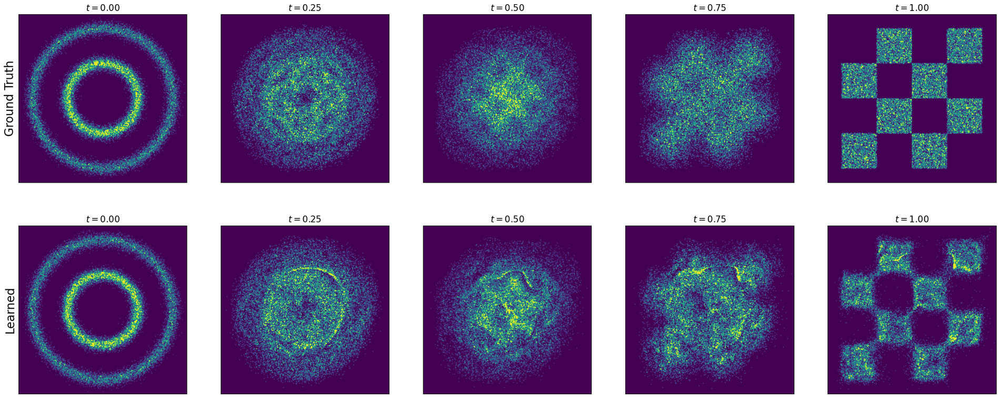

# MIT Diffusion 学习笔记

MIT 6.S184 · Introduction to Flow Matching and Diffusion Models · IAP 2026

这是一份课程学习记录，包含三份已实现的 Jupyter Notebook、配套中文推导笔记和课程讲义。内容从 ODE／SDE 的数值模拟出发，经过 Flow Matching 与 Score Matching，最后用带类别条件的 Diffusion Transformer 在像素和潜空间中生成 MNIST 图像。

[中文公式与实现笔记](MIT_DIFFUSION_LAB_NOTES.md) · [课程讲义 PDF](docs/course/flow-matching-and-diffusion-models-2506.02070v3.pdf) · [MIT 课程主页](https://diffusion.csail.mit.edu/2026/index.html)

## 三个实验

| 实验 | 内容 | 阅读入口 |
| --- | --- | --- |
| Lab 1 · ODEs and SDEs | Euler、Euler–Maruyama、Ornstein–Uhlenbeck 过程和 Langevin 采样 | [Notebook](lab_one.ipynb) · [推导](MIT_DIFFUSION_LAB_NOTES.md#lab-1) |
| Lab 2 · Flow and Score Matching | 高斯条件概率路径、速度场与 score 的训练目标、任意分布间的传输 | [Notebook](lab_two.ipynb) · [推导](MIT_DIFFUSION_LAB_NOTES.md#lab-2) |
| Lab 3 · Conditional Image Generation | Classifier-Free Guidance、像素空间 DiT、VAE 与潜空间生成 | [Notebook](lab_three.ipynb) · [推导](MIT_DIFFUSION_LAB_NOTES.md#lab-3) |



*Lab 2 的结果示例。更多结果图、张量形状和公式到代码的对照见中文笔记。*

## 在本地运行

下面的命令适用于 Windows PowerShell，使用 Conda、Python 3.12、PyTorch 2.10（CUDA 12.8）和 FFmpeg。运行 GPU 训练和环境检查需要支持该 CUDA 构建的 NVIDIA GPU 与驱动。

```powershell
git clone https://github.com/KissLoveOrKill/MIT_Diffusion.git
cd MIT_Diffusion
conda env create --prefix .\.venv --file environment.yml
conda run --prefix .\.venv --no-capture-output python register_kernel.py
.\start.ps1 -NoSolutions
```

打开任一 Notebook 后选择 **Python (MIT Diffusion)** 内核。Lab 3 首次运行数据单元格时会将 MNIST 下载到 `data/`，训练时将 checkpoint 和采样图像写入 `runs/`。仓库保留了 Notebook 的示例输出，可以直接阅读实验结果。

- `start.ps1` 启动 JupyterLab，可用 `-NoSolutions` 跳过打开课程参考解答，用 `-NoBrowser` 手动打开日志中的地址。
- 保存 Notebook 后，在启动终端按 `Ctrl+C` 关闭 JupyterLab，也可以在另一个终端运行 `./stop.ps1`。
- `requirements.txt` 定义直接依赖，`requirements-lock.txt` 记录已验证的 pip 包版本。设好 Python 3.12 与 FFmpeg 后，可执行 `python -m pip install -r requirements-lock.txt` 安装锁定版本。

### 环境检查

```powershell
conda run --prefix .\.venv --no-capture-output python check_environment.py
```

检查覆盖 Notebook 导入、Jupyter 内核、CUDA 前向与反向传播、`torch.func`、绘图和 FFmpeg 视频编码。结果写入本地 `environment-check.json`。

## 课程来源与许可

- 三份 Notebook 基于 Ezra Erives 和 Peter Holderrieth 的 [MIT 6.S184 IAP 2026 实验仓库](https://github.com/eje24/iap-diffusion-labs/tree/2026)，沿用其 [MIT License](LICENSE)。
- 课程讲义为 Peter Holderrieth 和 Ezra Erives 的 *An Introduction to Flow Matching and Diffusion Models*。仓库附带的 PDF 原样保留了 [arXiv:2506.02070v3](https://arxiv.org/abs/2506.02070v3)（2026 年 3 月 18 日）的内容，按 [CC BY-NC-ND 4.0](https://creativecommons.org/licenses/by-nc-nd/4.0/) 分发。
